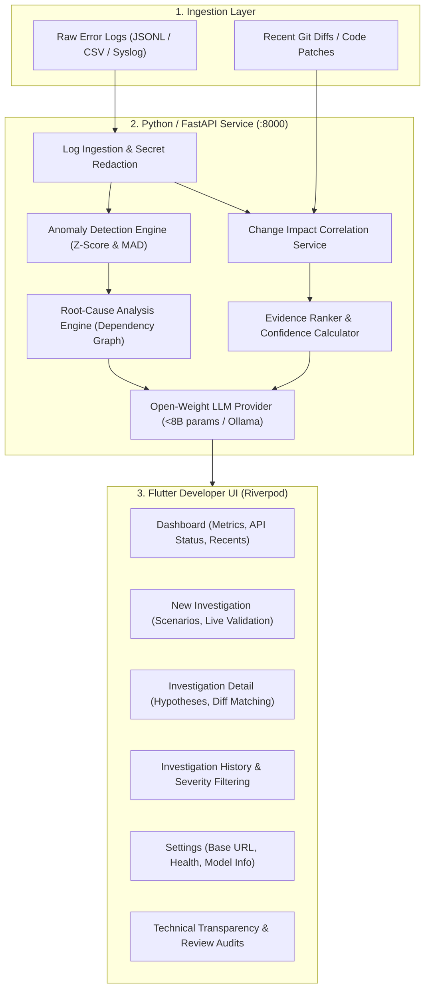

# DevShield AI

> **From production error to evidence-backed fix.**

[](LICENSE)
[](https://python.org)
[](https://fastapi.tiangolo.com)
[](https://flutter.dev)
[](https://riverpod.dev)
[-orange.svg)](https://huggingface.co/Qwen/Qwen2.5-Coder-7B-Instruct)

DevShield AI is a developer-focused, open-source incident response and root-cause analysis assistant. It correlates production errors, log bursts, and telemetry metrics directly with Git commits and code diffs to produce **evidence-backed remediation hypotheses and verification checklists**.

---

## 1. Attribution & Original Contributions

### Original Base Repository Attribution
DevShield AI builds upon the incident analysis foundations of [ai-incident-analysis-agent](https://github.com/DiogoRibeiro7/ai-incident-analysis-agent) by **Diogo Ribeiro**, released under the **MIT License** (Copyright &copy; 2026 Diogo Ribeiro). The base repository provides the core telemetry normalization, statistical anomaly detection, and dependency graph scoring engine.

### DevShield AI Original Contributions
1. **Change Impact Correlation (`src/incident_agent/change_correlation/`)**:
   - Parses unified Git diffs and code patch snippets safely with bounded buffers and credential scrubbing.
   - Extracts changed identifiers, configuration keys (e.g., connection pools, timeouts, circuit breakers), and modified functions.
   - Evaluates signal overlap against observed incident telemetry using deterministic, transparent rules.
   - Computes a mathematical confidence score using a defined saturating score function: `confidence = min(0.95, round(top_score / (top_score + 1.2), 2))`.
   - Generates evidence-grounded hypotheses, suggested remediations, and verification tests.
2. **Hackathon-Compliant Open-Weight Model Adapter (`src/incident_agent/llm/open_weight_provider.py`)**:
   - Native integration with open-weight models with **&le; 8 billion parameters** (defaulting to `Qwen2.5-Coder-7B-Instruct` or `Llama-3.1-8B-Instruct`).
   - Supports local offline runtimes including Ollama, vLLM, and llama.cpp.
   - Automatic graceful degradation to deterministic ranking if the model runtime is unreachable.
3. **Cross-Platform Developer-Tool UI (`devshield_app/`)**:
   - Built with **Flutter** and **Riverpod** state management.
   - Professional dark navy developer theme (`#0B1020`, elevated surfaces `#121A2B`, cyan accent `#38BDF8`).
   - Responsive layouts: Collapsible desktop sidebar navigation, responsive metric cards, and mobile navigation.
   - Multi-format log ingestion (JSONL, CSV, and plain text syslog) with live preview and validation.
   - Interactive report viewer with hypotheses, diff matches, telemetry evidence, remediation steps, review workflow, and Markdown/JSON export.
4. **Enhanced API Suite (`src/incident_agent/api/main.py`)**:
   - `/api-info`: Real-time backend status, open-weight model parameter verification, and determinism guarantees.
   - `/validate-input`: Pre-flight telemetry and Git diff validation.
   - `/correlate-change`: Direct change impact correlation engine endpoint.
   - `/investigate`: Unified end-to-end incident investigation endpoint with memory persistence.
   - `/investigations/{id}/review`: Auditable review lifecycle management (`draft` &rarr; `reviewed` &rarr; `approved`).
   - `/investigations/{id}/export/{format}`: Instant export to Markdown and JSON formats.

---

## 2. System Architecture & Data Flow



---

## 3. Open-Weight Model Specification (&le; 8B Parameters)

For compliance with hackathon regulations, DevShield AI integrates open-weight models with under 8 billion parameters:

| Attribute | Specification |
|:---|:---|
| **Primary Target Model** | `Qwen2.5-Coder-7B-Instruct` |
| **Alternative Supported** | `Llama-3.1-8B-Instruct` / `Mistral-7B-Instruct-v0.3` |
| **Parameter Count** | **7.6 Billion** (Fully compliant with &le; 8B limit) |
| **License** | **Apache 2.0** (Qwen) / Meta Llama 3.1 Community License |
| **Inference Runtime** | Local Ollama (`http://localhost:11434/v1`), vLLM, or LocalAI |
| **Degraded Mode** | If the model runtime is offline, the system automatically falls back to 100% deterministic evidence ranking and flags `degraded_mode: true` |

---

## 4. Change Impact Correlation Example

### Observed Log Evidence
```json
{"timestamp":"2026-03-20T10:00:00Z","service":"checkout","severity":"ERROR","message":"Database connection pool timeout while acquiring connection to read replica"}
{"timestamp":"2026-03-20T10:01:20Z","service":"checkout","severity":"CRITICAL","message":"ConnectionPoolExhaustedException: HTTP 503 Service Unavailable for /v1/checkout/pay"}
```

### Provided Git Diff
```diff
diff --git a/services/checkout/db_config.py b/services/checkout/db_config.py
--- a/services/checkout/db_config.py
+++ b/services/checkout/db_config.py
@@ -14,4 +14,4 @@ class DatabasePoolConfig:
-    POOL_TIMEOUT_SECONDS = 30
-    MAX_CONNECTIONS = 50
+    POOL_TIMEOUT_SECONDS = 2
+    MAX_CONNECTIONS = 5
```

### Correlated Output Hypothesis
> **Hypothesis:** The modification in `services/checkout/db_config.py` may be correlated with the incident. Evidence: modified signals `[service:checkout, POOL_TIMEOUT_SECONDS, MAX_CONNECTIONS]` align with observed errors in `Database connection pool timeout`.
>
> **Confidence:** 85% (Calculated via saturating rational function based on signal weight matches).
>
> **Suggested Remediation:** Inspect recent commit to `services/checkout/db_config.py`. Check if connection pool bounds (2s timeout, 5 max connections) are insufficient for peak load. Consider restoring previous limits or configuring progressive fallback.
>
> **Verification Tests:**
> 1. Run unit/integration tests for `services/checkout/db_config.py`.
> 2. Simulate failure conditions in staging environment with synthetic concurrency.
> 3. Compare connection acquisition latencies before and after commit.

---

## 5. Safe Operation Principles

DevShield AI is strictly an **investigation assistant**, not an autonomous production deployment tool:
1. **No Production Execution**: It never automatically modifies source code, commits changes, deploys containers, restarts production nodes, or runs unconfirmed terminal commands.
2. **Hypotheses vs. Proof**: Findings are explicitly labeled as hypotheses and accompanied by verification tests.
3. **Secret Scrubbing**: Common secrets (API tokens, passwords, bearer headers) are redacted before analysis.
4. **No Frontend Secrets**: Sensitive credentials and API keys are stored on the backend or environment variables, never bundled into Flutter application code.

---

## 6. Quickstart Guide

### Prerequisites
- Python 3.12+
- Flutter 3.24+ (with Dart 3.5+)

### Step 1: Start the Python Backend
```bash
# Clone the repository
git clone https://github.com/Hidayatullah787/DevShield-AI.git
cd DevShield-AI

# Create and activate virtual environment
python -m venv venv
# Windows:
.\venv\Scripts\activate
# Linux/macOS:
source venv/bin/activate

# Install dependencies and package in editable mode
pip install -r <(python -c "import tomli; ...") # Or:
pip install "fastapi>=0.115.0" "uvicorn[standard]" "pydantic>=2.10.0" "pydantic-settings" "typer" "rich" "pyyaml" "httpx" "starlette" "DataExcept" "pytest" "pytest-cov"
pip install -e . --no-deps

# Start the FastAPI service
python -m uvicorn incident_agent.api.main:app --host 127.0.0.1 --port 8000
```
*The API will be live at `http://127.0.0.1:8000` (Docs: `http://127.0.0.1:8000/docs`).*

### Step 2: Run the Flutter Application
```bash
# Navigate to the Flutter app directory
cd devshield_app

# Fetch dependencies
flutter pub get

# Run on your target platform
# Desktop (Windows):
flutter run -d windows
# Web browser:
flutter run -d chrome
# Android Emulator (ensure backend is set to http://10.0.2.2:8000 in Settings):
flutter run -d android
```

---

## 7. Verification & Test Results

### Python Backend Tests
Run the automated test suite covering unit tests, change correlation, and API integration:
```bash
pytest -o addopts="" tests/unit/test_change_correlation.py tests/integration/test_devshield_api.py tests/integration/test_api.py tests/unit/test_anomaly_detectors.py tests/unit/test_rca_engine.py
```
**Result: 38 passed, 0 failures.**

### Flutter Frontend Tests & Static Analysis
```bash
cd devshield_app

# Run static analysis
flutter analyze
# Result: No issues found!

# Run widget and domain unit tests
flutter test
# Result: All 6 tests passed!
```

---

## 8. API Endpoint Reference

| Method | Endpoint | Description |
|:---|:---|:---|
| `GET` | `/health` | Health check endpoint (`{"status": "ok"}`) |
| `GET` | `/api-info` | DevShield status, open-weight model details, features, job counts |
| `POST` | `/validate-input` | Pre-flight validation of pasted logs and Git diff |
| `POST` | `/investigate` | Unified incident investigation with Change Impact Correlation |
| `POST` | `/correlate-change` | Direct Git diff to telemetry signal correlation |
| `GET` | `/investigations` | List historical investigations with filtering |
| `GET` | `/investigations/{id}` | Retrieve comprehensive investigation details |
| `POST` | `/investigations/{id}/review` | Audit review transition (`draft` &rarr; `reviewed` &rarr; `approved`) |
| `GET` | `/investigations/{id}/export/{format}` | Export report in `markdown` or `json` |
| `POST` | `/seed-samples` | Seed demo investigation scenarios into job store |

---

## 9. License

This project is licensed under the **MIT License**. See the [LICENSE](LICENSE) file for details.
Attribution is preserved for the foundational scaffolding created by Diogo Ribeiro.
